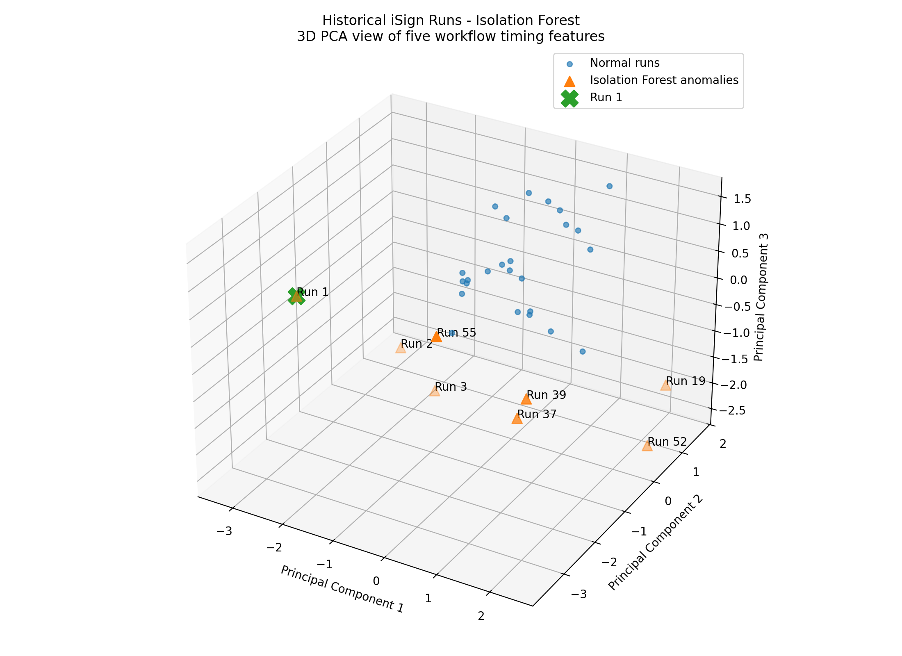


## Discussion point – 3D visualization of Isolation Forest results

An additional 3D PCA graph was prepared to better understand the Isolation Forest results from Chapter 5.

The Isolation Forest model used five timing features:

- SCP action setup
- Node.js setup
- dependency installation
- React build
- SCP transfer

Because five dimensions cannot be shown directly in one 3D graph, PCA was used only for visualization. PCA combines the five original timing features into three new axes called PC1, PC2 and PC3.

A simple way to understand these axes is:

- **PC1** shows the strongest overall difference between the workflow runs.
- **PC2** shows another important difference that is not already represented by PC1.
- **PC3** shows a third different timing pattern that is not already represented by PC1 and PC2.

For example, if some runs have generally low dependency-installation and React-build times while other runs have higher values, this difference may strongly affect one PCA axis. Another axis may be influenced more by differences in SCP transfer or Node.js setup.

Therefore, PC1, PC2 and PC3 are not individual workflow steps. Each axis is a different combination of the original five timing features.

The main purpose of this graph is to make the five-dimensional timing data easier to see and to help understand how normal and anomalous workflow patterns are positioned relative to each other.

PCA was not used by the Isolation Forest model to classify anomalies. It was added afterwards only as an exploratory visualization.




## Chapter 6 – Summary

- Chapter 5 identified repeated unusual behaviour in:
  - SCP action setup
  - SCP transfer
- Chapter 6 investigated whether this showed a **real optimization opportunity**.
- Existing **Docker-based SCP** was investigated first.
- Historical evidence showed unusually high SCP setup and transfer times.
- This did not immediately prove that Docker SCP was inefficient:
  - temporary network conditions could affect timing
  - temporary server conditions could affect timing
- **Native SCP** was tested as an alternative.
- GitHub runner already supported:
  - `ssh`
  - `scp`
  - `sshpass`
- Native SCP could transfer files without the Docker-based SCP action.
- The following were kept the same:
  - frontend project
  - build process
  - development server
  - deployment target
  - server synchronization
  - deployment verification
- One early Native SCP run took about **83 seconds**.
- The old measurement could not identify whether the delay came from:
  - SSH remote folder creation
  - SCP transfer
  - network conditions
  - server conditions
- Native SCP measurement was improved by separating:
  - SSH known-host preparation
  - remote deployment folder preparation
  - Native SCP file transfer
- Controlled experiment:
  - **10 Native SCP runs**
  - **10 Docker SCP runs**
  - runs executed one after another
  - methods alternated
  - same frontend project
  - same build process
  - same server
  - same deployment target
  - **20/20 deployments successful**

### Controlled results

| Metric                 | Native SCP | Docker SCP |
| ---------------------- | ---------- | ---------- |
| Runs                   | 10         | 10         |
| Mean SCP-related time  | 19.50 s    | 27.40 s    |
| Median                 | 20.00 s    | 27.00 s    |
| Standard deviation     | 1.96 s     | 3.13 s     |
| Minimum                | 17.00 s    | 23.00 s    |
| Maximum                | 23.00 s    | 34.00 s    |
| Range                  | 6.00 s     | 11.00 s    |
| Successful deployments | 10/10      | 10/10      |

- Mean reduction with Native SCP: **28.83%**
- Welch's two-sample t-test:
  - `p < 0.001`
  - statistically significant difference
- 95% confidence interval for Native − Docker:
  - **[-10.39 s, -5.41 s]**
  - entire interval below zero
- Native SCP showed:
  - lower mean execution time
  - lower median
  - lower standard deviation
  - smaller range
  - same deployment success rate
- **Native SCP selected as the optimization for the iSign frontend workflow.**
- Conclusion limited to:
  - tested iSign workflow
  - tested experimental conditions
- **Chapter 7:** formal before-and-after evaluation of the selected Native SCP optimization.


## Discussion point – Chapter 7 evaluation strategy

### Why Vitest was added

- The frontend project already contained **Vitest tests**.
- The original deployment workflow did **not execute the tests before deployment**.
- This was identified as a **CI/CD quality-gate gap**.
- A Vitest step was therefore added for the Chapter 7 evaluation.
- This allows the optimization to be evaluated not only for speed, but also while checking that the required frontend tests still pass.

### Current observation – With Vitest, Set 1

| Metric                     | Docker   | Native   |
| -------------------------- | -------- | -------- |
| Vitest                     | 14 s     | 25 s     |
| React build                | 5 s      | 7 s      |
| SCP-related time           | **22 s** | **17 s** |
| Whole build-and-deploy job | **64 s** | **71 s** |

### Whole job vs SCP part

```text
WHOLE JOB
Docker 64 s  ████████████████████████████████
Native 71 s  ████████████████████████████████████

SCP PART ONLY
Docker 22 s  ███████████
Native 17 s  █████████
```

- Whole job: Native = **7 s slower**
- SCP part: Native = **5 s faster**
- Vitest varied considerably: Docker **14 s**, Native **25 s**
- Therefore, total job duration does not show SCP performance alone.

### RQ3

**What measurable effect does one evidence-based CI/CD optimization have on workflow duration and resource use, while maintaining the required build, test, and deployment quality?**

### Chapter 7 approach

- Main evaluation: **Vitest-enabled Docker vs Native**
- Supporting diagnostic comparison: **no-Vitest Docker vs Native**
- Vitest runs evaluate performance together with the required quality gate.
- No-Vitest runs help isolate SCP behaviour.

### Main Chapter 7 metrics

| Area               | Measurement                           |
| ------------------ | ------------------------------------- |
| Workflow duration  | Workflow start → final job completion |
| Resource-use proxy | Sum of job execution times            |
| SCP performance    | SCP-related execution time            |
| Build quality      | Frontend build succeeds               |
| Test quality       | Same Vitest tests pass                |
| Deployment quality | Deployment + verification succeed     |
| Reliability        | Failures and reruns                   |

### Results to report

| Metric                            | Docker | Native | Difference |
| --------------------------------- | ------ | ------ | ---------- |
| Mean workflow duration            | XX s   | XX s   | XX%        |
| Mean aggregate job execution time | XX s   | XX s   | XX%        |
| Mean SCP-related duration         | XX s   | XX s   | XX%        |

### Statistical evaluation

- Mean, median, SD, range
- Percentage difference
- 95% confidence interval
- Welch's t-test

### RQ3 conclusion will answer

- Did Native reduce **workflow duration**?
- Did Native reduce **resource-use proxy**?
- Did Native reduce **SCP-related time**?
- Did build, Vitest, deployment and verification still succeed?

### Planned Chapter 8

- Interpret Chapter 7 results.
- Explain whole-job vs SCP-specific differences.
- Compare Chapter 6 and Chapter 7.
- Discuss runner, test, network and server variation.
- State limitations, final conclusions and future work.

