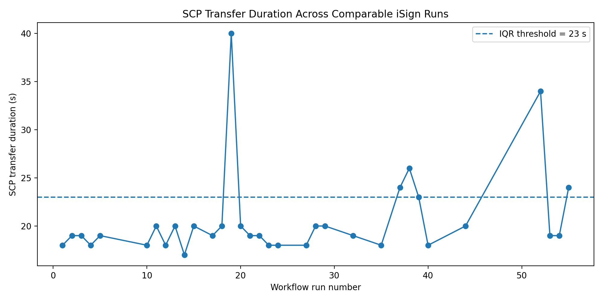
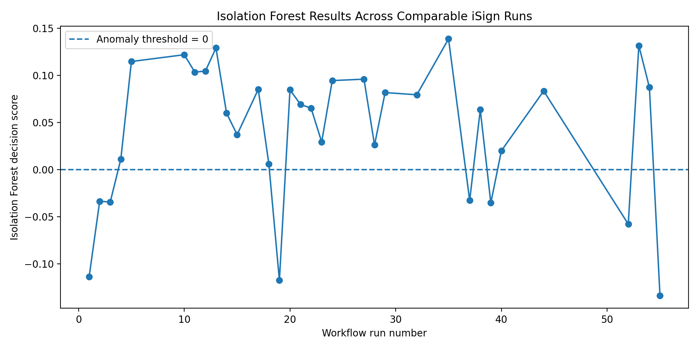
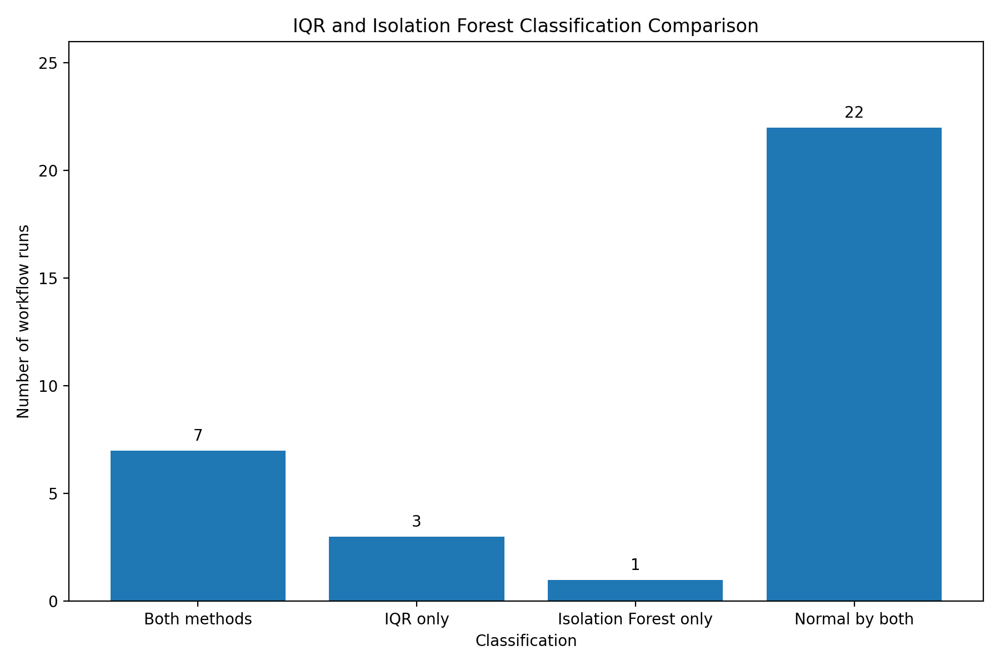

# 5. iSign Analysis Results

## 5.1 Dataset and Preprocessing

The selected case-study workflow is the iSign frontend GitHub Actions workflow `Deploy-to_Dev_Server.yml`.

The historical dataset contained 55 frontend workflow runs. After the comparability rules were applied, 33 successful full workflow runs were kept for analysis. These runs produced 495 step-level observations.

Only comparable runs were used. This means that the statistical analysis and the Isolation Forest analysis compare workflow runs that performed the same relevant work.

The processed dataset was prepared for:

- descriptive statistical analysis
- IQR-based anomaly detection
- Isolation Forest analysis
- comparison of the two methods

## 5.2 Statistical Baselines and IQR Results

### 5.2.1 Overall workflow and job-level baseline

Descriptive statistics were calculated for the workflow, job and selected step durations of the 33 comparable runs.

| Metric | Mean (s) | Median (s) | Q1 (s) | Q3 (s) | IQR (s) | Standard deviation (s) | Range (s) |
|---|---:|---:|---:|---:|---:|---:|---:|
| Total workflow duration | 70.55 | 70 | 64 | 73 | 9 | 8.96 | 57-90 |
| Check-commit-message job | 5.27 | 6 | - | - | - | 1.38 | 3-8 |
| Build-and-deploy job | 57.88 | 58 | 52 | 61 | 9 | 7.56 | 45-77 |
| SCP transfer step | 20.64 | 19 | 18 | 20 | 2 | 4.72 | 17-40 |

The first IQR analysis was used to find unusually long workflow and job durations. The calculated upper thresholds were:

- total workflow duration: 86.5 seconds
- build-and-deploy duration: 74.5 seconds
- SCP transfer duration: 23 seconds

Using these aggregate thresholds, runs 19, 37, 38, 52 and 55 were flagged as unusual in at least one measured duration.

**Figure 1.** SCP transfer duration across the 33 comparable iSign frontend workflow runs. The dashed line shows the IQR upper threshold of 23 seconds.

Figure 1 shows that runs 19, 37, 38, 52 and 55 were above the SCP transfer upper threshold. This aggregate analysis helps to show where slow behaviour appears in the workflow.

### 5.2.2 Common-feature IQR baseline for method comparison

For a direct comparison with Isolation Forest, a second IQR analysis was performed. It used exactly the same five step-duration features as Isolation Forest:

- SCP action setup
- Node.js setup
- dependency installation
- React build
- SCP transfer

For this comparison, both lower and upper IQR fences were used. This means that the IQR method can identify values that are unusually low or unusually high.

| Feature | Q1 (s) | Q3 (s) | IQR (s) | Lower fence (s) | Upper fence (s) |
|---|---:|---:|---:|---:|---:|
| SCP action setup | 3 | 5 | 2 | 0 | 8 |
| Node.js setup | 6 | 8 | 2 | 3 | 11 |
| Dependency installation | 5 | 7 | 2 | 2 | 10 |
| React build | 7 | 9 | 2 | 4 | 12 |
| SCP transfer | 18 | 20 | 2 | 15 | 23 |

A feature value was treated as an IQR outlier when it was below the lower fence or above the upper fence. A workflow run was flagged when at least one of the five features was outside its IQR fences.

The common-feature IQR analysis flagged 10 runs:

**2, 3, 4, 19, 22, 37, 38, 39, 52 and 55.**

This common-feature IQR result is used for the direct comparison with Isolation Forest in Section 5.4. The earlier aggregate IQR analysis is kept because it helps to explain the overall workflow behaviour.

## 5.3 Isolation Forest Results

Isolation Forest was applied to the same 33 comparable iSign frontend workflow runs.

The following five step-duration features were used:

- Build appleboy/scp-action@v0.1.7
- Setup Node.js
- Install dependencies
- Build React app
- Transfer build files via SCP

The Isolation Forest settings were:

- `n_estimators = 100`
- `contamination = "auto"`
- `random_state = 42`

The fixed random state helps to produce consistent results when the same data and settings are used.

Isolation Forest identified eight unusual workflow runs:

**55, 19, 1, 52, 39, 3, 2 and 37.**

**Figure 2.** Isolation Forest decision scores across the 33 comparable iSign frontend workflow runs. The dashed line at 0 separates normal runs from anomalous runs.

Figure 2 shows that runs with decision scores below 0 were classified as anomalous by Isolation Forest.

Isolation Forest looks at the five selected timing values together. Because of this, it can flag a run even when no single value is outside an IQR fence.

At this stage, an Isolation Forest anomaly only means that the run is unusual compared with the other runs. It does not automatically mean that the workflow has an inefficiency. The flagged runs must be investigated before an optimization is selected.

## 5.4 Comparison of IQR and Isolation Forest

For the direct comparison, both IQR and Isolation Forest were applied to the same 33 workflow runs and the same five step-duration features.

The comparison produced the following results:

- both methods flagged 7 runs: **2, 3, 19, 37, 39, 52 and 55**
- IQR only flagged 3 runs: **4, 22 and 38**
- Isolation Forest only flagged 1 run: **1**
- 22 runs were classified as normal by both methods

**Figure 3.** Comparison of common-feature IQR and Isolation Forest classifications for the 33 comparable iSign frontend workflow runs.

The two methods agreed on most of the unusual runs found by Isolation Forest. Seven of the eight Isolation Forest anomalies were also flagged by the common-feature IQR method.

However, the methods did not give exactly the same results. IQR flagged runs 4, 22 and 38, while Isolation Forest classified these runs as normal.

Isolation Forest flagged Run 1 even though none of its five individual feature values was outside an IQR fence. This shows an important difference between the methods. IQR checks each feature separately. Isolation Forest looks at the five timing values together.

Because both methods used the same runs and the same five features, the different results mainly come from how the methods analyse the same timing data.

This comparison does not prove that one method is more accurate than the other. The historical CI/CD data does not have verified labels showing which runs are truly anomalous. For this reason, the flagged runs must be investigated before they can be treated as real CI/CD inefficiencies.

## 5.5 Numerical Investigation of Flagged Runs

The corrected common-feature comparison changed some of the earlier run classifications. Therefore, the numerical investigation below uses the common-feature IQR result and the existing Isolation Forest result.

### 5.5.1 Run 55

Run 55 was flagged by both methods.

The SCP action setup took 14 seconds, while the common-feature IQR upper fence was 8 seconds. The SCP transfer took 24 seconds, which was also above its upper fence of 23 seconds.

Isolation Forest also classified Run 55 as anomalous.

The result shows unusual timing in two SCP-related features. However, this does not yet prove a CI/CD inefficiency. The workflow configuration and run logs still need to be investigated.

### 5.5.2 Run 19

Run 19 was flagged by both methods.

The SCP transfer took 40 seconds. The dataset median was 19 seconds and the IQR upper fence was 23 seconds. This was the highest SCP transfer duration among the 33 comparable runs.

Isolation Forest also classified Run 19 as anomalous.

The main visible reason for the IQR result is the unusually long SCP transfer.

### 5.5.3 Run 52

Run 52 was flagged by both methods.

The SCP transfer took 34 seconds, which was above the IQR upper fence of 23 seconds. Dependency installation took 9 seconds. This value was higher than its median, but it was still inside the IQR fences.

Isolation Forest also classified Run 52 as anomalous.

The main individual IQR signal is the long SCP transfer. Isolation Forest, however, checks all five timing values together.

### 5.5.4 Run 37

Run 37 was flagged by both methods.

The SCP action setup took 10 seconds, which was above its IQR upper fence of 8 seconds. The SCP transfer took 24 seconds, which was also above its upper fence of 23 seconds.

Isolation Forest also classified Run 37 as anomalous.

Therefore, Run 37 had two SCP-related values outside the IQR fences.

### 5.5.5 Run 38

Run 38 was flagged by IQR but not by Isolation Forest.

The SCP transfer took 26 seconds, which was above the IQR upper fence of 23 seconds. The other selected feature values stayed inside their IQR fences.

Isolation Forest classified the full five-feature timing pattern as normal.

Run 38 shows that one IQR outlier does not always make the whole run anomalous for Isolation Forest.

### 5.5.6 Runs 2 and 3

Runs 2 and 3 were flagged by both methods.

Both runs had a Node.js setup duration of 1 second. The common-feature IQR lower fence for Node.js setup was 3 seconds. Therefore, both values were unusually low according to IQR.

Isolation Forest also classified both runs as anomalous.

The earlier aggregate IQR analysis did not examine these low Node.js setup values. The common-feature IQR uses both lower and upper fences, so these low values are included in the fair comparison with Isolation Forest.

### 5.5.7 Run 39

Run 39 was flagged by both methods.

The SCP action setup took 11 seconds, which was above the IQR upper fence of 8 seconds. Dependency installation took 8 seconds and SCP transfer took 23 seconds. These values were inside, or exactly on, their IQR fences.

Isolation Forest also classified Run 39 as anomalous.

The corrected comparison therefore shows that Run 39 was flagged by both methods. IQR flagged the high SCP action setup value, while Isolation Forest evaluated all five timing values together.

### 5.5.8 Run 1

Run 1 was flagged only by Isolation Forest.

Its selected step durations were:

- SCP action setup: 3 seconds
- Node.js setup: 4 seconds
- dependency installation: 2 seconds
- React build: 4 seconds
- SCP transfer: 18 seconds

None of these values was outside the common-feature IQR fences. Values exactly equal to a fence were not treated as outside the fence.

Isolation Forest still classified the run as anomalous.

Run 1 is the clearest example in the current iSign dataset where Isolation Forest flagged the full five-value timing pattern even though IQR did not flag any single feature.

### 5.5.9 Runs 4 and 22

Runs 4 and 22 were flagged by IQR but not by Isolation Forest.

Run 4 was flagged because its Node.js setup duration was outside the common-feature IQR fence. Run 22 was flagged because its SCP action setup duration was outside the common-feature IQR fence.

Isolation Forest classified both complete five-feature timing patterns as normal.

Together with Run 38, these cases show that one unusual feature value does not always make the full run anomalous for Isolation Forest.

At this point, the numerical classification and the method comparison are complete. The next stage is to check the workflow configuration and the relevant run or log evidence before deciding whether any of these unusual timing results show a real CI/CD inefficiency.
