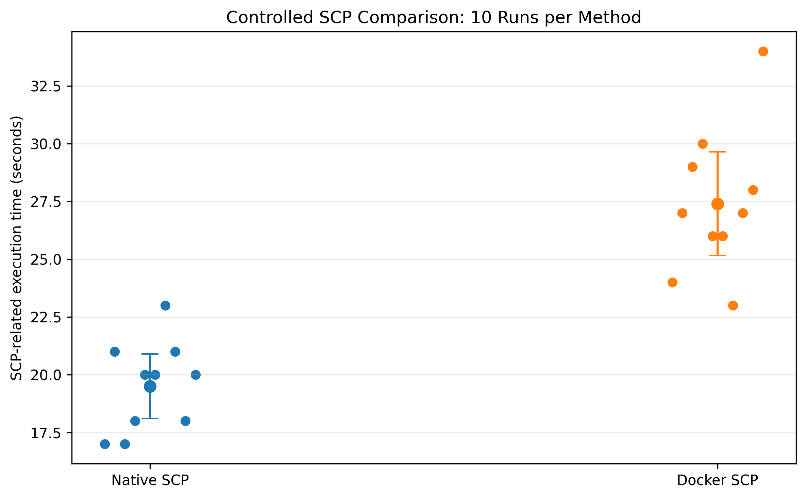

# 6 Technical Investigation and Optimization Selection

## 6.1 Purpose of the Technical Investigation

Chapter 5 showed that the SCP-related deployment steps had the most frequent unusual behaviour in the analysed iSign frontend workflow. Noticeably higher execution times were found especially in the SCP action setup and SCP transfer steps.

However, an unusual execution time does not always mean that the workflow is inefficient. Therefore, a technical investigation was needed before choosing any optimization.

The purpose of this chapter is to investigate the SCP deployment stage in detail and determine whether there is a real improvement opportunity. The existing Docker-based SCP method is investigated first. Then, Native SCP is tested as an alternative method.

The decision is made after careful consideration of workflow evidence, deployment logs and controlled measurements. The optimization is chosen only if the results show a useful improvement while the deployment continues to work successfully.
### 6.2.1 Existing Docker-based SCP Implementation

The current iSign frontend deployment workflow uses GitHub Actions to build and deploy the React application to the development server. The workflow can start when code is pushed to the `development` branch, or it can be triggered manually.

Before the build-and-deploy process starts, the workflow confirms whether the latest commit message contains the word `Deploy`. If this requirement is satisfied, the `build-and-deploy` job continues.

The deployment process first checks out the frontend source code, sets up Node.js 20 and installs the project dependencies using `npm install`. After this, the workflow executes the lint step and builds the React application using `npm run build`.

The production-ready frontend files in the `dist` directory are transferred to the development server using `appleboy/scp-action@v0.1.7`. The workflow uses GitHub Secrets for the server address, username, password and SSH port. The build files are first transferred to the `/tmp/isign-dev_deploy` directory on the server.

Following the SCP transfer, a separate SSH action starts the server-side deployment service. Another SSH action then checks the frontend deployment directory to ensure that `index.html` exists. This verification step is used to confirm that the deployment process finished successfully.

This existing Docker-based SCP approach was used as the baseline for the technical investigation in this chapter.
### 6.2.2 Historical SCP Evidence

The Chapter 5 analysis identified repeated unusual execution times in the SCP steps.

For the SCP action setup, the IQR upper fence was 8 seconds. Runs 22, 37, 39 and 55 had setup times exceeding this limit, taking 9, 10, 11 and 14 seconds.

Several unusually high execution-time values were also found in the SCP transfer step. Runs 19, 37, 38, 52 and 55 had transfer times exceeding the IQR upper limit of 23 seconds.

The workflow logs were reviewed to understand these delays better. In Run 55, the SCP action setup took 14 seconds and the full SCP transfer step took 24 seconds. Since the actual file transfer inside this step took only around 9 seconds, this indicates that setup and other operations related to the transfer consumed a larger part of the total time.

A similar pattern was found in Run 39. The SCP action setup took 11 seconds, while the actual file transfer took around 9.7 seconds.

Run 52 showed different behaviour. The SCP transfer step took 34 seconds, and the actual file transfer took about 22.7 seconds. The size of the build output was not unusually large compared with the other runs. Therefore, the delay could not be explained by a larger build output, and temporary network or server conditions remained possible causes.

The workflow logs of some previous runs, for example Runs 19 and 37, were no longer accessible. Therefore, the exact cause of every unusual SCP result could not be verified.

In general, the historical records indicated that the SCP stage showed repeated unusual execution delays, but the delays did not always have the same cause. Because of this, a deeper technical investigation of the SCP deployment method was needed before selecting an optimization.
### 6.3.1 Initial Native SCP Feasibility Testing

Native SCP was tested as a direct alternative to the Docker-based action, after looking at the earlier SCP behaviour.

The first step was checking if the GitHub Ubuntu runner already had the needed SSH and SCP tools. The test showed that `ssh`, `scp` and `sshpass` were available. Because of this, the files could be sent directly from the runner without the Docker action.

The main deployment process was kept almost the same. The frontend app was built in the same way. The same development server and deployment location were used. Only the SCP transfer method was changed.

In the first native SCP version, the workflow prepared the SSH connection, made the remote folder and copied files from the `dist` directory using native commands. The server-side synchronization and verification steps were not changed.

The first four native SCP runs worked successfully. The SCP-related times were 18, 20, 20 and 19 seconds. These early results looked promising because native SCP completed the same deployment task faster than the existing Docker-based method.

However, four runs were not enough to make a final decision. These results were therefore used only as early feasibility evidence, and more controlled runs were needed before selecting the final optimization.
### 6.3.2 Investigation of the 83-Second Native SCP Run

One run in the early native testing was very slow. Run 41505105060 took about 83 seconds for the SCP step, but the other native runs were much faster.

The workflow log was checked to see where this extra delay came from.

The `ssh-keyscan` part took 3 seconds. That was close to the normal time from the other runs. The rest of the delay happened later inside the same step. However, the log did not separate the operations.

At that time, remote folder creation and the actual SCP transfer were measured together. This was a problem. The old log could show that the delay happened after `ssh-keyscan`, but it could not show whether most of the extra time came from the folder-creation command, the SCP transfer itself, or a temporary server or network issue.

The exact cause of the 83-second result could not be confirmed. It would not be correct to say that the delay came only from the SCP transfer, SSH setup or the server.

This result showed that the measurement method needed to be improved. Before selecting the final optimization, the native SCP workflow needed to measure each main part separately.
### 6.3.3 Improved Timing Instrumentation

Because the 83-second run could not be explained accurately from the old log, the native SCP workflow was changed to get better timing data for each step.

The earlier version measured several SSH-related operations inside one single step, which made it difficult to find out which operation caused a delay.

The improved workflow separated the native deployment into three steps. This allowed the actual time consumption of each step to be investigated:

- preparing SSH known hosts with `ssh-keyscan`
- creating the remote deployment folder using SSH
- sending build files using native SCP

This change made the timing data more detailed. If another slow native run happened, it would be possible to investigate whether the delay came from SSH preparation, remote folder creation or the file transfer itself.

The existing server-side synchronization and deployment verification steps were kept unchanged, because the main objective was only to improve the measurement and not to change the main deployment behaviour.

During the later controlled runs, `ssh-keyscan` normally took around 3 to 4 seconds, remote folder preparation took around 4 to 6 seconds, and the native SCP transfer usually took around 9 to 15 seconds.

Extreme cases like the 83-second workflow run did not appear again in the new test runs. This did not provide evidence that such a delay could never happen again, but the improved measurement gave better information for the controlled comparison.
### 6.4.1 Controlled Comparison – Experimental Setup

After improving the timing measurements in the native SCP workflow, a broader controlled comparison was carried out between native SCP and the existing Docker-based SCP method.

The controlled comparison contained 20 runs: 10 native SCP runs and 10 Docker SCP runs. The runs were carried out one after another. This was important because running both methods at the same time could lead to competition for resources such as the network, server or disk.

The runs were alternated between native SCP and Docker SCP. This helped to reduce the effect of temporary changes in network or server conditions affecting only one method.

The same frontend project, build process, development server and deployment target were used for both methods. The main difference was the SCP transfer implementation.

For native SCP, the total SCP-related time was measured from three time values:

- SSH known-host preparation
- remote deployment folder preparation
- native SCP file transfer

For Docker SCP, the total SCP-related time was measured from:

- Docker SCP action setup
- SCP file transfer

All 20 controlled runs completed successfully. The collected results were then used for the descriptive and statistical comparison.
### 6.4.2 Descriptive Results

The controlled comparison results showed a clear observed difference between the two SCP methods.

The mean SCP-related execution time for native SCP was 19.50 seconds, while Docker SCP had a mean of 27.40 seconds. The difference between the two means was 7.90 seconds.

The median time for native SCP was 20 seconds, while the median for Docker SCP was 27 seconds.

Native SCP also showed less variation in this controlled sample, with a standard deviation of 1.96 seconds compared with 3.13 seconds for Docker SCP.

The native SCP results ranged from 17 to 23 seconds. Docker SCP results ranged from 23 to 34 seconds.

Native SCP showed a lower mean execution time. The reduction was about 28.83% compared with Docker SCP.

All 10 native SCP runs and all 10 Docker SCP runs completed successfully. No deployment failure was recorded in this controlled comparison.

| Metric | Native SCP | Docker SCP |
| --- | ---: | ---: |
| Number of runs | 10 | 10 |
| Mean | 19.50 s | 27.40 s |
| Median | 20.00 s | 27.00 s |
| Standard deviation | 1.96 s | 3.13 s |
| Minimum | 17.00 s | 23.00 s |
| Maximum | 23.00 s | 34.00 s |
| Range | 6.00 s | 11.00 s |
| Successful deployments | 10/10 | 10/10 |

These descriptive results show that the mean SCP-related execution time was lower for native SCP, and native SCP also had less variation in this controlled sample.

Figure 4 gives a visual comparison of the controlled native SCP and Docker SCP measurements. Each point represents one workflow run. The mean and 95% confidence interval for each group are also shown.

The figure shows that the native SCP measurements were generally lower and more closely grouped than the Docker SCP measurements.
### 6.4.3 Statistical Comparison

The descriptive results showed that native SCP had a lower mean execution time than Docker SCP. An inferential statistical test was also conducted to determine whether the difference between the sample means was statistically significant.

Since the two groups had different standard deviations, Welch's two-sample t-test was used because this method does not require equal variances.

The hypotheses for the two-sided test were:

$$
H_0:\mu_{Native}=\mu_{Docker}
$$

$$
H_1:\mu_{Native}\neq\mu_{Docker}
$$

The mean difference was calculated as

$$
\bar{x}_{Native}-\bar{x}_{Docker}=19.50-27.40=-7.90\text{ s}
$$

The negative value shows that the mean native SCP time was lower.

Welch's two-sample t-test showed a statistically significant difference,

$$
t(15.10)=-6.76,\quad p<0.001
$$

The 95% confidence interval for the mean difference was

$$
95\%\,CI=[-10.39,\,-5.41]\text{ s}
$$

The complete confidence interval was below zero, which supports that the mean native SCP execution time was lower than the mean Docker SCP execution time under the tested conditions.

Since the p-value was below the significance level of 0.05, the null hypothesis was rejected. The controlled comparison therefore provides statistical evidence that the two mean execution times were different. Together with the negative mean difference and confidence interval, the results show that native SCP had the lower mean execution time in this experiment.

These results do not support a claim that native SCP will always be faster in every environment or every future workflow run. The conclusion is limited to the tested iSign workflow and the specific conditions applied in this experiment.
### 6.5 Optimization Selection

The main objective of the technical investigation was to decide whether the SCP deployment stage contained a real improvement opportunity and whether native SCP could be selected as the optimization.

The evidence collected in this chapter supports selecting native SCP.

The earlier analysis showed repeated unusual delays in the Docker-based SCP setup and transfer steps. The GitHub-hosted runner proved capable of supporting native SCP, which successfully executed the same deployment task while leaving the main build, server-side synchronization and verification steps unchanged.

The larger controlled comparison provided stronger evidence. Native SCP had a mean SCP-related execution time of 19.50 seconds, compared with 27.40 seconds for Docker SCP, representing an approximate 28.83% decrease. All 10 native runs and all 10 Docker runs completed successfully.

Welch’s two-sample t-test showed a statistically significant difference, and the 95% confidence interval for the mean difference remained below zero.

Based on these results, native SCP was selected as the optimization for the iSign frontend deployment workflow.

This decision is limited to the tested conditions. The results do not prove that native SCP will always be faster in every environment. The formal before-and-after evaluation of the selected optimization is continued in Chapter 7.
### 6.6 Chapter Summary

This chapter focused on the SCP deployment stage, as the Chapter 5 results strongly suggested SCP as the main area for technical investigation.

The historical analysis showed repeated unusual execution delays in both the Docker-based SCP setup and transfer steps. Native SCP was then tested as a possible alternative. The initial tests showed promising execution times, but one 83-second native run created uncertainty. Unfortunately, the old workflow did not measure the SSH and SCP operations separately, which led to improving the measurement method.

The workflow measurement was improved by separating SSH known-host preparation, remote folder creation and the actual native SCP transfer into individual measured steps. After this change, a new controlled comparison was carried out using 10 native SCP runs and 10 Docker SCP runs, alternated and executed one at a time.

Native SCP had a mean SCP-related execution time of 19.50 seconds. Docker SCP had a mean of 27.40 seconds. This represented an average reduction of about 28.83%. All 20 controlled runs completed successfully.

Welch's two-sample t-test showed a statistically significant difference, and the 95% confidence interval for the mean difference remained below zero.

Based on the technical investigation, native SCP was selected as the optimization for the iSign frontend workflow.

The next chapter evaluates the optimization using formal before-and-after measurements. It determines whether the improvement can be achieved while maintaining the required build, test and deployment quality.