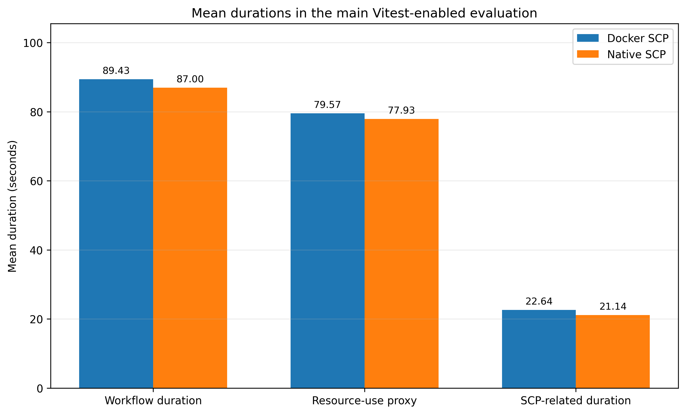
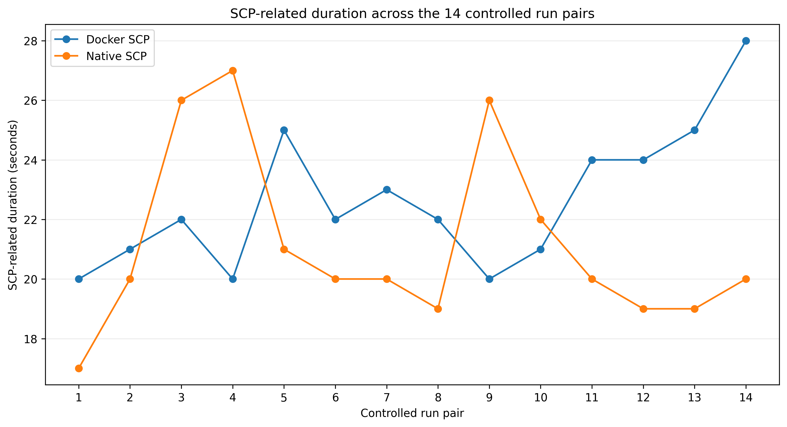
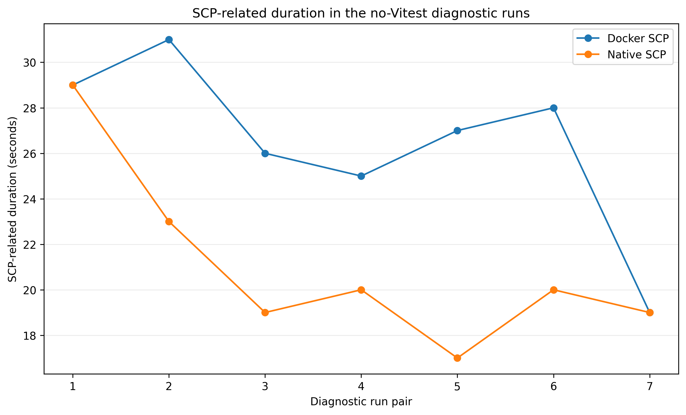

# 7 Evaluation of the Selected Optimization

## 7.1 Purpose of the Evaluation

Chapter 6 selected Native SCP as the optimization for the iSign frontend deployment workflow. This decision was based on the technical investigation and the controlled Docker-versus-Native comparison.

Chapter 7 evaluates the measurable effect of this selected optimization under controlled conditions. The focus is on Research Question 3:

**RQ3. What measurable effect does one evidence-based CI/CD optimization have on workflow duration and resource use, while maintaining the required build, test, and deployment quality?**

The evaluation considers both performance and quality. Performance is examined at the whole-workflow level and at the SCP stage. For resource use, total job execution time is used as a proxy rather than direct CPU or memory measurements. Quality is evaluated by checking frontend build success, test success, deployment success, deployment verification, and workflow reliability.

The main evaluation compares Docker SCP with Vitest against Native SCP with Vitest. Additional diagnostic checks are examined separately. These help to study timing variation and to separate SCP behaviour from variation in other workflow stages.

## 7.2 Implementation of the Evaluated Workflow

The previous deployment method used the Docker-based `appleboy/scp-action` to transfer the frontend files to the development server. For the optimization, this was replaced with native SCP commands executed directly on the GitHub-hosted runner.

The main technical difference between the two workflows is how SCP is implemented.

**Docker SCP workflow:**

- set up the Docker-based SCP action
- transfer the frontend files using the action

**Native SCP workflow:**

- set up SSH known hosts
- prepare the remote deployment folder
- transfer the frontend files using the native `scp` command

Everything else remained the same. The frontend project, Node.js setup, dependency installation, React build, development server, deployment target, file synchronization, and verification step were unchanged.

The frontend project already contained Vitest tests, but the previous deployment workflow did not run them before deployment. For the Chapter 7 evaluation, the same Vitest step was added to both the Docker and Native workflows. Vitest therefore acts as a shared quality gate and is not part of the SCP optimization itself.

The command used in both workflows was:

`npm run test:run -- --exclude "**/*.integration.test.js"`

The backend-dependent integration tests were excluded because the required backend service was not available in this deployment workflow. The remaining frontend test suite contained 76 passing tests.

## 7.3 Controlled Evaluation Design

Docker SCP and Native SCP were tested under the same setup. The frontend project, Node.js version, dependencies, Vitest command, React build, development server, deployment target, file synchronization, and verification were kept the same.

The only main change was the SCP implementation. Docker used `appleboy/scp-action`, while Native used SSH and the native `scp` command.

The runs were executed one by one, with the order alternated between Docker and Native. This was done to avoid always running one method first.

For every run, workflow, job, and individual step timings were recorded. Build success, Vitest success, deployment success, and verification success were also recorded.

The results reported in this chapter are based on the 28 runs included in the main evaluation dataset.

The controlled comparison was used as the main evaluation dataset. Runs without Vitest were kept outside the main dataset and used only as supporting diagnostic evidence.

## 7.4 Evaluation Metrics

We used several metrics to evaluate performance and quality.

**Workflow duration** means the time from the start of the workflow until the final job was completed.

**Resource-use proxy** is the total of all job execution times. This indirect measure was used because direct CPU and memory usage data were not available.

**SCP-related duration** measures only the deployment steps related to SCP.

Docker SCP includes:

- SCP action setup
- SCP transfer

Native SCP includes:

- SSH known-host preparation
- remote folder preparation
- native SCP transfer

**Build quality** is evaluated by checking whether the frontend production build completes successfully.

**Test quality** checks whether the same Vitest suite and test count pass in both workflows.

**Deployment quality** means that the deployment and verification steps complete successfully.

**Reliability** is evaluated from the successful completion of the included workflow runs.

## 7.5 Primary Evaluation Results

The main evaluation included 14 Docker SCP runs and 14 Native SCP runs. Both had the Vitest check enabled.

**Table 7.1. Descriptive statistics for the main Vitest-enabled evaluation**

| Metric | Method | N | Mean (s) | Median (s) | SD (s) | Min (s) | Max (s) | Range (s) |
|---|---|---:|---:|---:|---:|---:|---:|---:|
| Workflow duration | Docker | 14 | 89.43 | 87.0 | 12.72 | 77 | 129 | 52 |
| Workflow duration | Native | 14 | 87.00 | 86.5 | 9.68 | 74 | 111 | 37 |
| Resource-use proxy | Docker | 14 | 79.57 | 80.0 | 5.75 | 71 | 88 | 17 |
| Resource-use proxy | Native | 14 | 77.93 | 77.5 | 7.12 | 67 | 91 | 24 |
| SCP-related duration | Docker | 14 | 22.64 | 22.0 | 2.34 | 20 | 28 | 8 |
| SCP-related duration | Native | 14 | 21.14 | 20.0 | 3.03 | 17 | 27 | 10 |

**Figure 7.1. Mean durations in the main Vitest-enabled evaluation**

Figure 7.1 compares the mean workflow duration, resource-use proxy, and SCP-related duration for Docker SCP and Native SCP in the main Vitest-enabled evaluation. In all three measures, the Native SCP mean was lower than the Docker SCP mean.

For workflow duration, the Docker mean was 89.43 seconds and the Native mean was 87.00 seconds. Native was 2.43 seconds faster on average, which is a 2.72% reduction. However, the p-value was 0.5749, so the difference was not statistically significant. The 95% confidence interval was from -11.24 to 6.38 seconds.

For the resource-use proxy, the Docker mean was 79.57 seconds and the Native mean was 77.93 seconds. Native reduced the mean by 1.64 seconds, or 2.06%. This difference was also not statistically significant (p = 0.5079). The 95% confidence interval was from -6.68 to 3.39 seconds.

For SCP-related duration, the Docker mean was 22.64 seconds and the Native mean was 21.14 seconds. Native was 1.50 seconds faster on average, giving a 6.62% reduction. The difference was still not statistically significant (p = 0.1558). The 95% confidence interval ranged from -3.61 to 0.61 seconds.

**Table 7.2. Statistical comparison of Docker SCP and Native SCP**

| Metric | Native - Docker (s) | Native reduction (%) | Welch t | df | p-value | 95% CI (s) |
|---|---:|---:|---:|---:|---:|---:|
| Workflow duration | -2.43 | 2.72 | -0.568 | 24.27 | 0.5749 | -11.24 to 6.38 |
| Resource-use proxy | -1.64 | 2.06 | -0.672 | 24.89 | 0.5079 | -6.68 to 3.39 |
| SCP-related duration | -1.50 | 6.62 | -1.465 | 24.42 | 0.1558 | -3.61 to 0.61 |

Therefore, the full Vitest-enabled evaluation showed lower mean times for Native SCP in all three measures. However, these differences were not statistically significant.

**Figure 7.2. SCP-related duration across the 14 controlled run pairs**

Figure 7.2 shows the SCP-related duration for each controlled Docker-versus-Native pair in the main Vitest-enabled dataset. In most pairs, Native SCP had a lower SCP-related duration than Docker SCP. However, some pairs showed the opposite result, which illustrates the run-to-run variation seen in the evaluation. This pair-level variation helps explain why the Native SCP mean was lower overall, but the final difference was not statistically significant.

## 7.6 Diagnostic Analysis

We did a separate check for the Vitest step. Vitest was the same in both workflows and was not part of the SCP change. Therefore, a large or consistent difference in Vitest time between Docker and Native would indicate that other workflow variation was affecting the total duration.

Across the 14 Docker runs, the mean Vitest time was 20.36 seconds. Across the 14 Native runs, the mean was 20.43 seconds. The difference was only 0.07 seconds.

The Welch test showed a p-value of 0.9654. The 95% confidence interval for the Native-minus-Docker difference ranged from -3.28 to 3.43 seconds.

This does not show a statistically significant difference in Vitest time between the two workflows. Therefore, the observed Vitest variation was treated as run-to-run variation rather than evidence of an effect from the SCP implementation.

We did a second diagnostic check on seven paired Docker and Native runs. These runs did not include the Vitest step and were kept separate from the main dataset. They were used to examine the SCP-related part of the workflow with fewer unrelated timing components.

Across the seven no-Vitest pairs, the mean SCP-related duration was 26.43 seconds for Docker and 21.00 seconds for Native. Native was therefore 5.43 seconds faster on average, corresponding to a 20.54% reduction.

The runs were executed as matched pairs, so a paired t-test was used. The result was statistically significant (t = -3.596, p = 0.0114). The 95% confidence interval for the Native-minus-Docker difference ranged from -9.12 to -1.73 seconds.

Native was faster in five of the seven pairs and equal to Docker in two pairs. None of the pairs showed a longer SCP-related duration for Native.

This diagnostic evidence supports that Native SCP can reduce SCP-related duration under the no-Vitest diagnostic conditions. However, it does not replace the main 14-by-14 Vitest-enabled evaluation. In the main evaluation, the SCP-related difference was smaller and was not statistically significant.

**Figure 7.3. SCP-related duration across the seven no-Vitest diagnostic pairs**

Figure 7.3 shows the paired SCP-related durations in the no-Vitest diagnostic runs. Native SCP was faster in five pairs and equal to Docker SCP in two pairs.

## 7.7 Build, Test and Deployment Quality

All 28 runs in the main dataset passed the quality checks. The quality gates worked correctly in these runs.

**Table 7.3. Quality results in the main evaluation dataset**

| Quality check | Docker SCP | Native SCP |
|---|---:|---:|
| Vitest | 14/14 | 14/14 |
| Frontend build | 14/14 | 14/14 |
| SCP transfer | 14/14 | 14/14 |
| File synchronization | 14/14 | 14/14 |
| Deployment verification | 14/14 | 14/14 |
| Complete build-and-deploy job | 14/14 | 14/14 |

All 14 Docker runs and all 14 Native runs completed the Vitest step successfully. The frontend build also completed successfully in every run.

The SCP transfer, file synchronization, and deployment verification steps passed in all 28 runs. The complete build-and-deploy job also finished successfully for every included run.

Therefore, replacing Docker SCP with Native SCP did not reduce the build, test, or deployment quality in the main dataset. Both methods achieved a 100% success rate.

The reported success rate applies only to the 28 runs included in the main evaluation dataset.

## 7.8 Answer to Research Question 3

RQ3 asks what measurable effect one evidence-based CI/CD optimization has on workflow duration and resource use, while maintaining the required build, test, and deployment quality.

Under the Chapter 7 evaluation conditions, replacing Docker SCP with Native SCP gave lower mean values in all three performance measures.

The mean workflow duration decreased from 89.43 to 87.00 seconds, which is a 2.72% reduction. The resource-use proxy decreased from 79.57 to 77.93 seconds, giving a 2.06% reduction. The SCP-related duration decreased from 22.64 to 21.14 seconds, which is a 6.62% reduction.

However, all p-values were above 0.05, so the differences were not statistically significant. The Chapter 7 results therefore do not provide enough evidence to claim that Native SCP significantly reduced overall workflow duration, the resource-use proxy, or SCP-related duration under these tested conditions.

The required quality was maintained. All 14 Docker runs and all 14 Native runs passed Vitest, the frontend build, SCP transfer, synchronization, deployment verification, and the complete build-and-deploy check.

Therefore, the measurable result is that Native SCP had lower mean execution times and maintained the required build, test, and deployment quality. However, the performance improvement was not statistically significant in the final 14-by-14 Vitest-enabled evaluation.

## 7.9 Summary of the Evaluation

Chapter 7 evaluated the Native SCP optimization selected in Chapter 6. It was compared with Docker SCP under controlled conditions.

The main evaluation included 14 Docker runs and 14 Native runs. Both used the same Vitest quality gate. Native SCP gave lower mean times for workflow duration, the resource-use proxy, and SCP-related duration. However, none of the differences was statistically significant.

The separate Vitest check also showed no statistically significant difference between the two workflows. Therefore, the observed Vitest timing differences were treated as run-to-run variation rather than an effect of the SCP change.

All 28 runs in the main dataset passed Vitest, the frontend build, transfer, synchronization, and deployment verification. Therefore, the selected optimization maintained the required quality under the tested conditions.

The results showed reductions in mean execution times with Native SCP. However, the final evaluation did not provide enough statistical evidence to claim a significant performance improvement. These findings are discussed further in Chapter 8.

